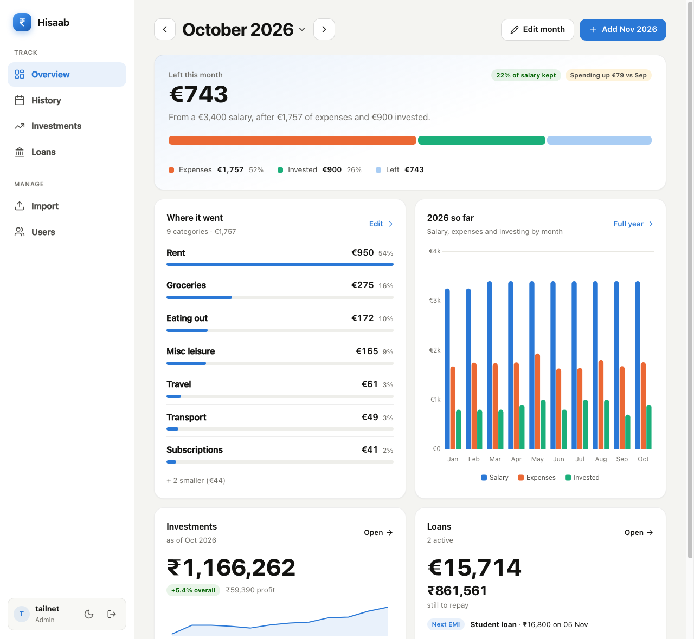
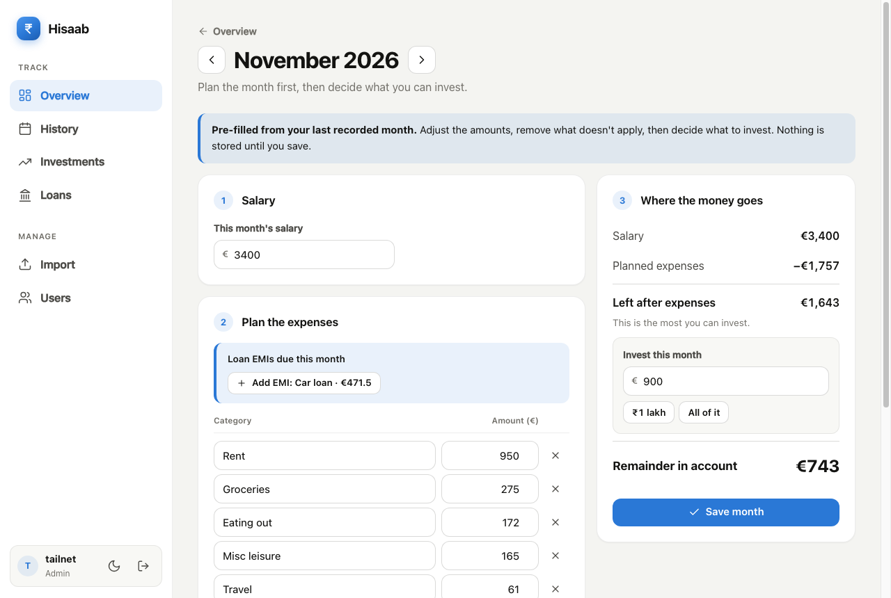
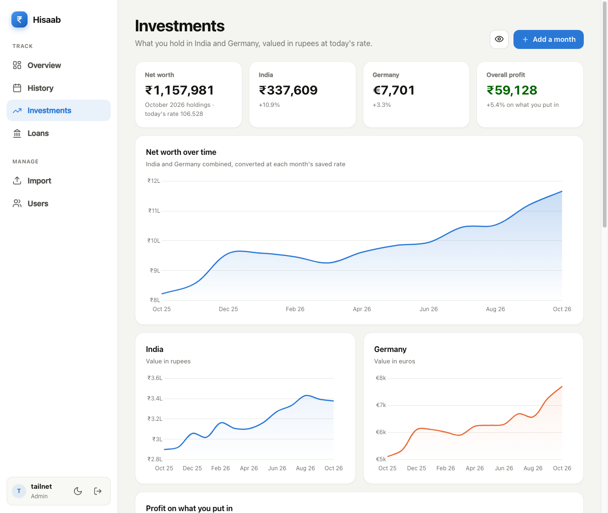
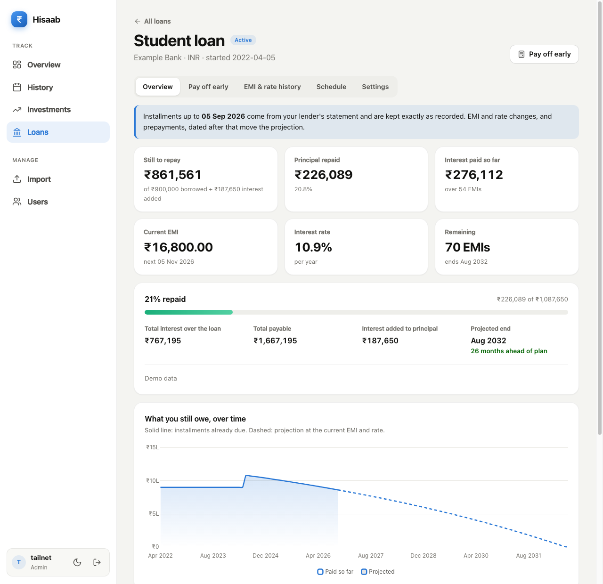
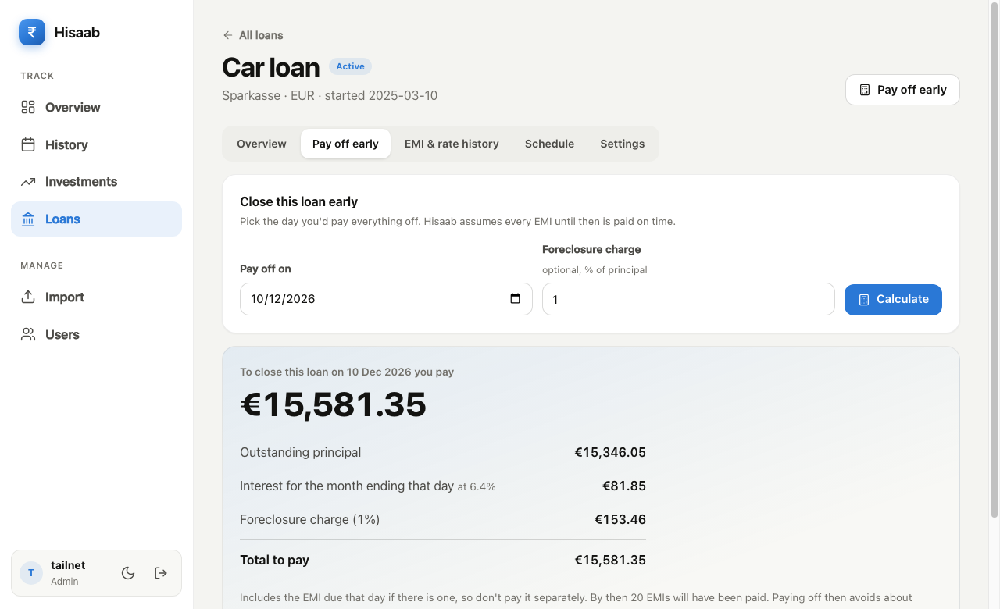
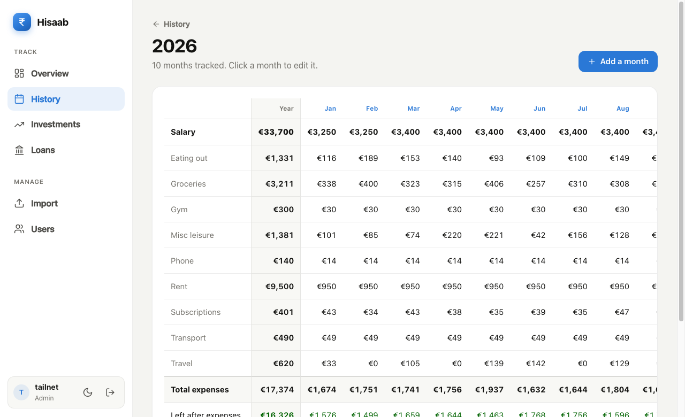
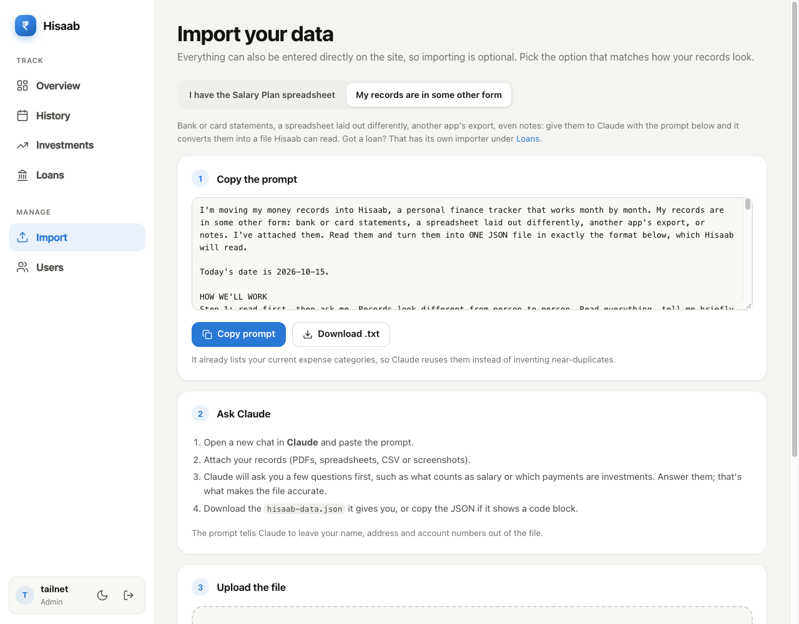
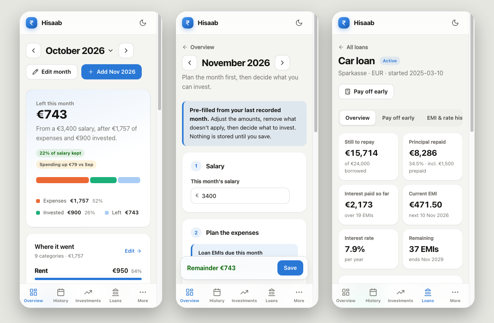

# Hisaab — हिसाब

**A private, self-hosted money tracker.** Plan each month, see what's left, follow your
investments in rupees and euros, and keep track of loans down to the last EMI. It runs as one small
container on a Raspberry Pi (or anywhere else), behind [Tailscale](https://tailscale.com),
and your numbers never leave your own hardware.

*Hisaab* (हिसाब) is Hindi for "accounts" or "the reckoning", as in *hisaab rakhna*: to keep one's accounts.

<picture>
  <source media="(prefers-color-scheme: dark)" srcset="docs/screenshots/overview-dark.png">
  
</picture>

*All numbers in the screenshots are made-up demo data.*

## What it does

- **Month planner.** Start each month by listing expected expenses (your regular ones are
  pre-filled from last month). A live panel shows what's *left after expenses*, how much you *can
  invest*, and the *remainder in your account* once you decide.
- **Overview.** One answer first: *how much is left this month*, with a bar showing where the salary
  went, category bars, a year chart, and your net worth and loans at a glance.
- **History.** Every year as a card, and a spreadsheet-style grid (categories × months) with year totals.
- **Investments.** Monthly snapshots of what you hold in India (₹) and Germany (€); net worth, profit and
  profit % are worked out, valued at today's EUR→INR rate. A privacy eye blurs the page for demos.
- **Loans and EMIs.** Any loan, in eight currencies, with separate dated histories for the EMI and the
  interest rate (including temporary windows for floating rates), prepayments, the full repayment
  schedule, charts, and a **pay-off calculator** that tells you what closes the loan on a chosen day.
- **Bring your data in.** From the old Excel sheet, or from *anything else* (bank statements, other apps,
  a lender's repayment schedule) with a prompt you give Claude, which writes a file Hisaab validates and
  lets you review before anything is saved.
- **Several people, separate money.** Add your partner as a user. Each person has their own completely
  private data; even admins can't see anyone else's.
- **Light and dark**, on desktop and phone.

<table>
<tr>
<td width="50%"><picture><source media="(prefers-color-scheme: dark)" srcset="docs/screenshots/planner-dark.png"></picture><br><sub><b>Month planner</b>: plan, then decide what to invest</sub></td>
<td width="50%"><picture><source media="(prefers-color-scheme: dark)" srcset="docs/screenshots/investments-dark.png"></picture><br><sub><b>Investments</b>: net worth and profit over time</sub></td>
</tr>
<tr>
<td><picture><source media="(prefers-color-scheme: dark)" srcset="docs/screenshots/loan-dark.png"></picture><br><sub><b>A loan</b>: still to repay, interest, projection</sub></td>
<td><picture><source media="(prefers-color-scheme: dark)" srcset="docs/screenshots/payoff-dark.png"></picture><br><sub><b>Pay off early</b>: what closes the loan on a given day</sub></td>
</tr>
<tr>
<td><picture><source media="(prefers-color-scheme: dark)" srcset="docs/screenshots/history-dark.png"></picture><br><sub><b>History</b>: the whole year in one grid</sub></td>
<td><picture><source media="(prefers-color-scheme: dark)" srcset="docs/screenshots/import-dark.png"></picture><br><sub><b>Import</b>: turn any records into a file Hisaab can read</sub></td>
</tr>
</table>

<picture>
  <source media="(prefers-color-scheme: dark)" srcset="docs/screenshots/mobile-dark.png">
  
</picture>

## Quick start

**Try it on your computer** (Python 3.12):

```sh
python3 -m venv .venv && source .venv/bin/activate
pip install -r requirements.txt
uvicorn app.main:app --reload
```

Open <http://127.0.0.1:8000>. The first run asks you to create the admin account through a private
link that is printed in the terminal (`/setup?token=…`).

**Run it for real** on a Raspberry Pi with Docker, reachable from your phone anywhere through
Tailscale: follow the [deployment guide](docs/DEPLOYMENT.md). In short:

```sh
git clone https://github.com/saurabhmete/hisaab.git && cd hisaab
docker compose up -d --build
```

## Documentation

| Guide | What's in it |
|---|---|
| [User guide](docs/USER_GUIDE.md) | How to use every part of the app, step by step |
| [Deployment](docs/DEPLOYMENT.md) | Raspberry Pi, Docker, Tailscale, updating, backups and restoring, troubleshooting |
| [Import formats](docs/IMPORT_FORMATS.md) | The Excel layout and the two JSON files Claude produces, field by field |
| [Architecture](docs/ARCHITECTURE.md) | How it works inside: data layout, privacy model, the loan maths, tests |
| [Changelog](CHANGELOG.md) | What changed, and when |

## Privacy and security at a glance

- **Your data stays on your hardware.** SQLite files in `data/`. No cloud service, no analytics. The
  only outside request the app makes is for the day's EUR→INR rate (and it works without it).
- **Everyone's data is separate.** Each person has their own database file, chosen from who is logged in.
  A new account starts empty. Removing an account deletes its data.
- **Sign-in protection.** Passwords are stored as salted PBKDF2 hashes; sessions are `HttpOnly`
  cookies (`Secure` over HTTPS); five wrong passwords from one address lock it out for 15 minutes; the
  first-run setup page needs a private token so a stranger can't claim the admin account.
- **Not encrypted at rest.** Anyone with access to the Pi itself can read the database files. Keep the
  Pi secure and back it up. See [Architecture → Security](docs/ARCHITECTURE.md#security-model).

## Tech

FastAPI, SQLite (standard library `sqlite3`, no ORM), server-rendered Jinja templates, a little vanilla
JavaScript, and Chart.js (bundled, so it works offline). No build step, no Node. Five Python packages in
[`requirements.txt`](requirements.txt).

## Tests

```sh
python -m tests.test_loans        # loan maths, payoff, rate windows, statements (51 checks)
python -m tests.test_data_import  # the import file validator (18)
python -m tests.test_pages        # every page renders, empty and with data (4)
python -m tests.test_isolation    # one person never sees another's money (6)
python -m tests.check_browser     # loads every page in headless Chrome, fails on any console error
```

The last one needs Google Chrome or Chromium and is skipped politely without it.

## Project layout

```
app/
  main.py            routes, sign-in middleware
  database.py        accounts + per-person databases, schema, migrations
  loans.py           loan engine: schedule, summary, payoff, storage
  loan_import.py     loan import: the prompt, the validator, storing it
  data_import.py     months/investments import (same idea)
  importer.py        the Excel ("Salary Plan") importer
  rates.py           live EUR→INR rate (cached, optional)
  icons.py           inline SVG icons and the logo
  templates/         Jinja pages
  static/            style.css, app.js, chart.umd.js
scripts/backup.sh    nightly backup of every database
tests/               the suites above
docs/                guides and screenshots
import_excel.py      command-line Excel import
Dockerfile, docker-compose.yml
```

*A personal project. Use it, change it, make it yours.*
